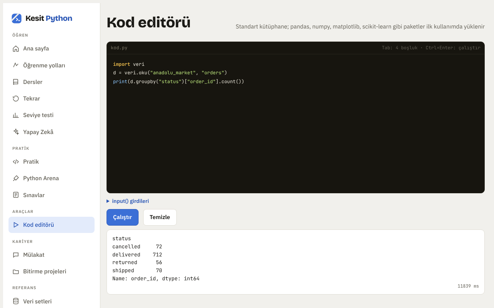
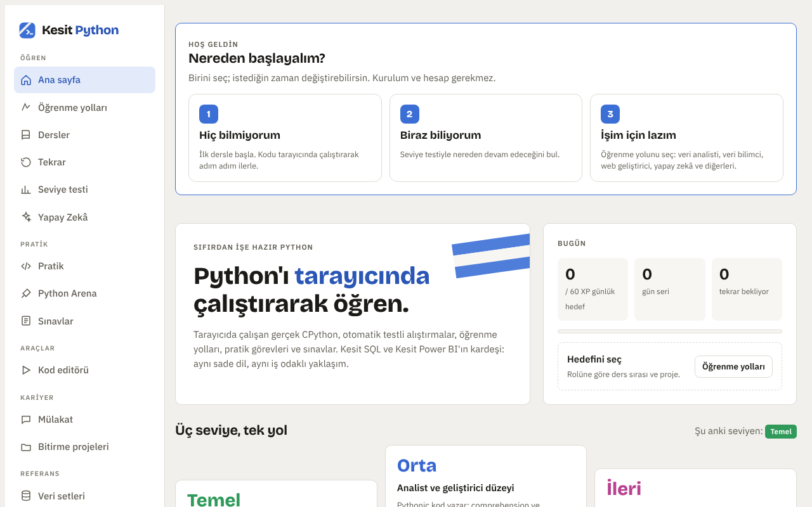
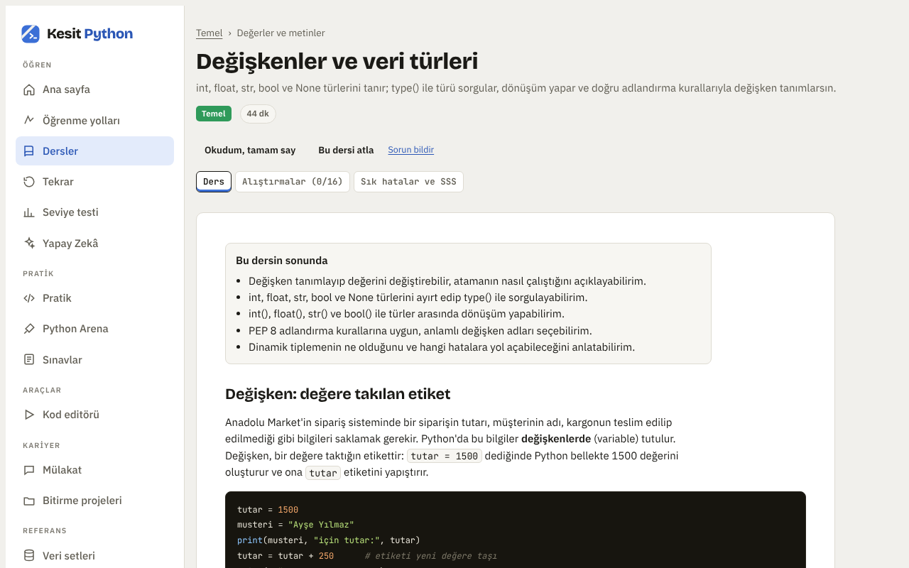
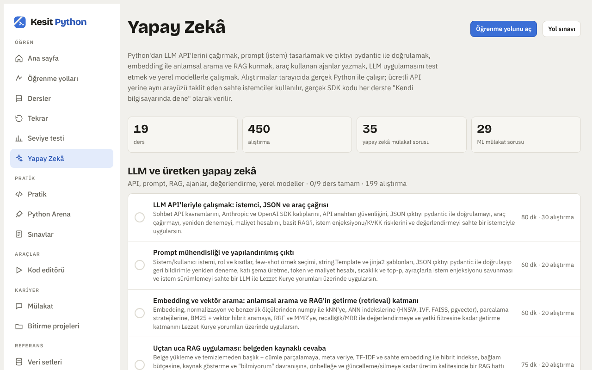

# Kesit Python

**Sıfırdan işe hazır seviyeye Türkçe Python eğitimi. Kurulum yok, hesap yok.** Tarayıcında çalışan gerçek Python motoruyla (Pyodide) kod yazarsın; alıştırmalar otomatik testlerle anında denetlenir.

**Dene:** https://ysfdurak.github.io/kesit-python/

## Neler var?
- **156 ders, 3.240 ders içi alıştırma, 562 pratik görevi.** Dili sıfırdan öğretir; otomasyon, veri analizi, web, makine öğrenmesi ve LLM uygulamalarına uzanır. Kurulum isteğe bağlıdır ("Bilgisayarına geç" bölümü).
- **11 öğrenme yolu:** veri analisti, veri bilimci, veri mühendisi, backend, web, makine öğrenmesi, yapay zekâ, otomasyon ve diğerleri. Her yolda ön koşul, sınav, role süzülmüş mülakat soruları ve portföy önerileri.
- **250 Python Arena problemi, 292 Python mülakat sorusu, 160 sık hata kaydı, 18 sınav.**
- **8 kurgusal veri seti:** e-ticaret, banka, İK, yemek teslimatı, havayolu, bisiklet paylaşımı, Power BI modeli ve kirli veri.

| Karşılama | Ders | Yapay zekâ |
|---|---|---|
|  |  |  |

## Nasıl çalışıyor?
- Sunucu yok: Python kodu CPython'ın WebAssembly sürümü olan Pyodide ile tarayıcıda, ayrı bir iş parçacığında (Web Worker) çalışır. Sonsuz döngü sayfayı dondurmaz; Durdur düğmesi ve 60 saniyelik süre sınırı motoru yeniden başlatır.
- İlerleme yalnızca kullanıcının tarayıcısında saklanır; Profil sayfasından dosyaya kaydedilip başka cihazda birleştirilerek yüklenebilir. Site kişisel veri toplamaz.
- Python motoru ve kütüphaneler ilk kod çalıştırmada jsDelivr'dan iner; site dosyaları ilk ziyarette tarayıcı önbelleğine alınır, yeni sürümde eski önbellek silinir.
- Alıştırma çözümleri otomatik testlerle gerçek Python'da denetlenir; denetim araçları `kaynak` dalındadır.

## Bilinen sınırlar
- Tarayıcıda gerçek iş parçacığı, süreç ve doğrudan ağ yok; bu konuları anlatan dersler kendi bilgisayarında beklenen çıktıyı yazar. Flask, Django, Docker, Spark gibi araçların alıştırmaları taklit eder, "Kendi bilgisayarında" görevleri gerçeğini çalıştırmanı ister.
- input() girdileri kod çalışmadan önce verilir.

## Kaynak kod ve kardeş projeler
Uygulamanın düzenlenebilir kaynağı, derleme ve test araçları [`kaynak` dalındadır](https://github.com/ysfdurak/kesit-python/tree/kaynak). Aynı mantıkla hazırlanmış diğer eğitimler: **[Kesit SQL](https://ysfdurak.github.io/kesit-sql/)** ve **[Kesit Power BI](https://ysfdurak.github.io/kesit-powerbi/)**. Banka, İK, teslimat, havayolu ve bisiklet veri setleri üç uygulamada aynıdır; Anadolu Market'te aynı şirket ve siparişler kullanılır, Power BI modeli zenginleştirilmiştir.

## Yapay zekâ kullanımı
Ürün kararlarını ve kapsamı Yusuf Durak belirledi; kod ve içerik yapay zekâ (Claude) ile geliştirildi.

## Açık kaynak bileşenler
- [Pyodide](https://pyodide.org) (MPL-2.0) ve içinde gelen paketler, kendi lisanslarıyla
- Yazı tipleri: Bricolage Grotesque, IBM Plex Sans, JetBrains Mono (SIL Open Font License; metinler `vendor/fonts` içinde)

## Sorumluluk notu
Ücretsiz, ticari olmayan bir eğitim ve portföy projesidir; içerik “olduğu gibi” sunulur. Veri setlerindeki tüm şirketler, kişiler ve kayıtlar hayalidir. Python Software Foundation ya da Python Institute ile bağlantılı değildir.

## Lisans
- Uygulama kodu: [MIT](LICENSE)
- Ders içerikleri ve veri setleri: [CC BY-NC 4.0](LICENSE-ICERIK.md)
