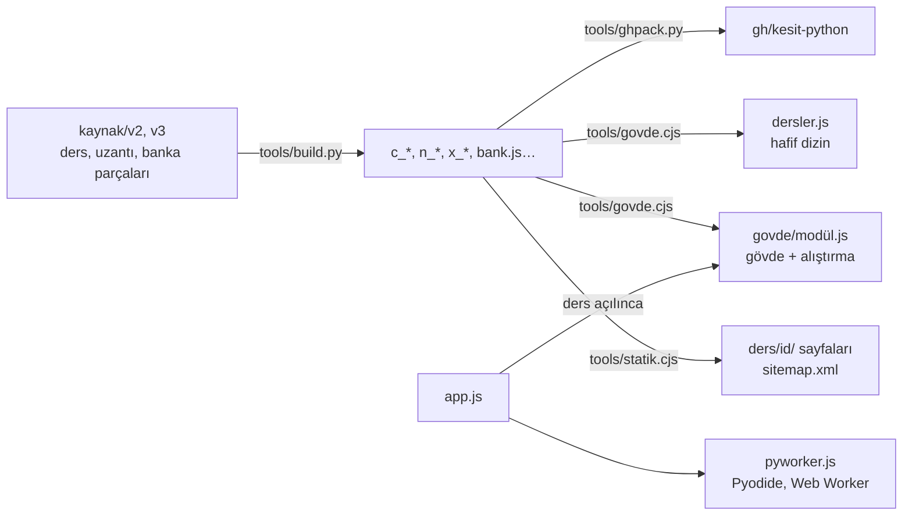

# Kesit Python · proje rehberi

Yaşayan hâkimiyet dokümanı: projeyi açıp anlatabilmen ve bir mülakatta kararları savunabilmen için. Komutlar `NASIL.md` içindedir. Doğrulanmamış bilgi **[doğrulanacak]** diye işaretlidir.

## 1. Bir bakışta

| | |
|---|---|
| Ne | Tarayıcıda gerçek Python (Pyodide) ile Türkçe Python eğitimi: ders, otomatik testli alıştırma, pratik, Python Arena, mülakat, sınav, öğrenme yolları |
| Kimin için | İlk satırını yazacak olandan veri analisti, otomasyon, backend, ML ve LLM uygulaması yazan geliştiriciye |
| Canlı | https://ysfdurak.github.io/kesit-python/ |
| Depo | `ysfdurak/kesit-python`; `kaynak` = kaynak + araçlar + üreteçler, `main` = `gh/kesit-python` paketi |
| Sayılar (Kasım 2026 sonu) | 156 ders, 3.255 ders içi alıştırma (1.961 kod, 609 seçmeli, 479 çıktı tahmini, 169 sıralama, 37 kendi bilgisayarında), 562 pratik, 250 Arena, 18 sınav |
| Sunucu | Yok. Python, Web Worker'da Pyodide 0.27.8 ile çalışır (jsDelivr'dan, sürümlü, önbellekte kalır); ilerleme `localStorage` (`pythonpatika.v1`) |
| Lisans | Kod PolyForm Shield 1.0.0, içerik CC BY-NC 4.0 |

## 2. Sorun ve kararlar

- **Gerçek Python, sahte değil:** Alıştırmalar tarayıcıda gerçekten çalışır ve testle denetlenir. Dış sistem isteyen görevler (FastAPI, Redis, bulut) "benzetim" diye etiketlenir; bilgisayarda yapılacaklar "kendi bilgisayarında" türündedir.
- **İçerik üreteçlerle yazılır:** Beklenen değerler gerçek veriden hesaplanır (`uretec/`); JS elle düzenlenmez, üreteci düzenlenir.
- **Kasım 2026, açılış küçültme:** Bütün dersler açılışta yükleniyordu (12 MB). Ders dizini açılışta, gövdeler ders açılınca gelir (13. bölüm).

## 3. Mimari

## 4. Teknoloji seçimleri

| Seçim | Neden | Elenen |
|---|---|---|
| Pyodide, Web Worker | Gerçek CPython, sayfa donmaz, süre sınırında işçi yeniden başlatılır | Sunucuda kod çalıştırmak: güvenlik ve maliyet |
| Hazırlığı derlemede yapmak (`govde.cjs`) | Gövdeler sonradan geldiği için tarayıcıda hazırlık yapılamaz; derlemede bir kez yapınca iki sürümde aynı ilerleme anahtarları çıkar | Tarayıcıda her modül gelince hazırlık: alıştırma anahtarı ders listesi çizilirken gerekir |
| Modül başına dosya | 29 dosya, ortalama 350 KB: bir ders açılınca yalnız kendi modülü iner | Seviye başına (3 dosya, ileri ~6 MB), ders başına (156 küçük istek) |

## 5. Kod turu

- `kaynak/app.js` başı: dersleri hazırlar. `PY_HAZIR` varsa (yayın paketi) bu adımlar atlanır.
- `kaynak/app.js` › `govdeYukle`, `bekleyenGovde`, `render`: ders ya da tekrar ekranı açılırken gövdesi gelmemiş modül varsa "Ders yükleniyor…" gösterir, dosyayı indirir, ekranı yeniden çizer; yüklenemezse açıklayıcı uyarı.
- `tools/govde.cjs`: `app.js`'in hazırlık satırlarını metin olarak alıp Node'da çalıştırır (tek doğruluk kaynağı), dizini ve modül dosyalarını yazar, statik sayfaları üretir.
- `kaynak/v3/k1/kurulum_kod.js`: kurulum derslerinin kod görevleri.

## 6. Sunucu ve yayın

Sunucu yok. `python3 tools/ghpack.py` → `gh/kesit-python/` → `main` dalına PR. Ortak altyapı için `ysfdurak.com` › `docs/NASIL-CALISIR.md`.

## 7. Testler (bu turun örneklemi)

| Adım | Beklenen | Gözlenen | Durum |
|---|---|---|---|
| Kaynak ve paket sürümünde 156 dersin alıştırma anahtarı, sırası, gövde uzunluğu | Birebir aynı | Aynı (fark 0) | ✓ |
| `uitest.py` kaynak ve `UI_KOK=gh/kesit-python` | TEMİZ | TEMİZ (562 pratik, 18 sınav) | ✓ |
| Ders doğrudan adresle, gövde gecikmeli | "Ders yükleniyor…", sonra ders | Tuttu | ✓ |
| Gövde dosyası yüklenemezse | Açıklayıcı uyarı | Tuttu | ✓ |
| Tekrar ekranında başka modülden görev | Modül iner, görev görünür | Tuttu | ✓ |
| Kurulum kod görevleri CPython ve Pyodide | PASS 15 | PASS 15 | ✓ |
| `metinval.js` | sorun 0 | 0 | ✓ |
| Gerçek telefonda yavaş bağlantı | Ders birkaç saniyede açılır | Denenmedi | **[doğrulanacak]** |

> **Burada bir test daha yapalım:** Android telefonda mobil veriyle siteyi ilk kez aç (önbellek temiz), bir İleri dersine git; açılış ve ders yükleme süresini not et.

## 8. Bilinen sınırlar ve sonraki adımlar

- Pratik bankası (`bank.js`, 1,3 MB) ve sınavlar (`exams.js`) hâlâ açılışta yükleniyor. **Şöyle daha iyi olur:** pratik ve sınav ekranlarına girilince yüklenebilirler (aynı `govdeYukle` deseni).
- Gövde dosyaları önbelleğe ilk açılışta alınmaz; çevrimdışıyken yalnız daha önce açılmış modüller çalışır.

## 9. Mülakat soruları

1. **Açılışı nasıl 3,5 MB'tan 0,6 MB'a indirdin?** Ders gövdelerini ve tam alıştırmaları modül dosyalarına böldüm; açılışta yalnız ders dizini iner. Hazırlık adımlarını derlemeye taşıdım ki ilerleme anahtarları aynı kalsın.
2. **Bölünmüş sürümün eskisiyle aynı davrandığını nasıl kanıtladın?** İki sürümü tarayıcıda açıp bütün modülleri yükledim; 156 dersin alıştırma kimlikleri, sırası ve gövde uzunlukları birebir aynı çıktı. UI testi iki sürümde de temiz.
3. **Neden hazırlık kodunu kopyalamadın da `app.js`'ten okuyorsun?** Tek doğruluk kaynağı: iki kopya zamanla ayrışır ve ilerleme anahtarları değişirse öğrencinin kaydı boşa düşer.
4. **Dinamik eklenen betik sayfanın `load` olayını geciktirir mi?** Evet; ayrıştırma sırasında eklenen async betik `load`'u bekletir. Testlerde `domcontentloaded` ile beklemek gerekti; kullanıcı için ekran zaten çizilmiş olur.

## 10. Kendini test et

`PY_HAZIR` nedir, neden gerekir?
Paketteki dizinin hazırlığının derlemede yapıldığını söyler; tarayıcı aynı adımları ikinci kez yapmaz (terim parantezi iki kez eklenmesin, anahtarlar değişmesin).

Tekrar ekranı hangi dosyaları indirir?
Vadesi gelen tekrar anahtarlarının ait olduğu derslerin modül dosyalarını; hepsi gelince ekran çizilir.

## 11. Elle yapılacak alıştırma

**Kod (15 dk):** `kaynak/v3/k1/kurulum_kod.js` içinde `vscode` dersine ikinci bir görev ekle: `launch.json` metninden `"program"` alanını oku. Sonra `python3 tools/verify.py kaynak/v3/k1/kurulum_kod.js` ve `python3 tools/ghpack.py`.

**5 dakikalık demo:** (1) Ağ sekmesi açıkken siteyi aç: açılışta ~2 MB. (2) Bir İleri dersine gir: tek bir `govde/…js` iner. (3) Kod görevini çalıştır: Pyodide Worker'da. (4) Statik ders sayfasını göster.

## 12. Değişiklik günlüğü

| Tarih | Değişiklik |
|---|---|
| 2026-11-22 | pandas 3 denetimi (CPython), Windows kendi bilgisayarında görevleri |
| 2026-11-27 | Ders gövdeleri modül modül (açılış 3,5 → 0,6 MB gzip), statik ders sayfaları derlemede (156), kurulum derslerine 15 kod görevi, bu rehber |
